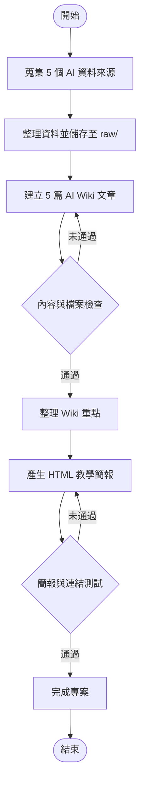

# My Learning Wiki — Workflow Design

## 1. 工作流程說明

本專案以人工智慧（AI）為主題，建立個人知識庫，並利用知識庫內容製作 HTML 教學簡報。

整體流程分成資料蒐集、資料整理、Wiki 建立、內容檢查、簡報生成及成果測試六個階段。

## 2. Workflow Diagram

## 3. 各階段說明

| 階段 | 工作內容 | 檢查方式 |
|---|---|---|
| Data Collection | 蒐集 5 個 AI 資料來源 | 確認資料來源及主題 |
| Data Ingestion | 將資料整理至 raw/ | 確認檔案是否存在 |
| Wiki Creation | 建立 5 篇 AI Wiki | 檢查文章內容及分類 |
| Review | 檢查文章與檔案路徑 | 確認文章可以正常讀取 |
| Slide Generation | 製作 HTML 教學簡報 | 確認頁面及內容 |
| Final Testing | 測試簡報與 Wiki 連結 | 確認切換及連結正常 |

## 4. Loop 設計

本專案有兩個主要的重複檢查流程：

1. Wiki 內容檢查：如果文章內容或檔案路徑有問題，就回到 Wiki 建立階段修改，直到文章能正常讀取。
2. 簡報成果檢查：如果簡報頁面或延伸閱讀連結無法正常運作，就回到簡報製作階段修正，再重新測試。

這樣可以避免錯誤一路累積到最後才被發現。

## 5. 流程設計原因

將內容檢查放在簡報生成之前，可以先確認知識庫的內容是否完整，減少錯誤資訊進入簡報。

另外，簡報完成後仍需要進行實際操作測試，確認頁面切換、文章連結及 Markdown 顯示都正常。